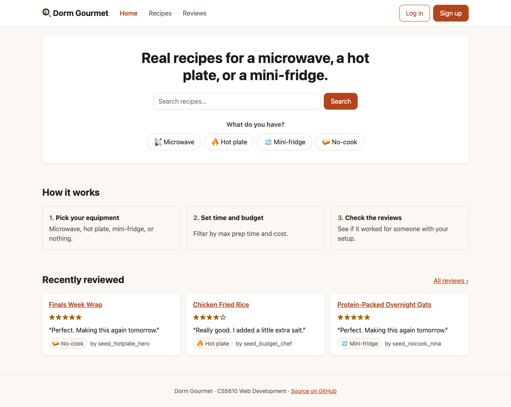
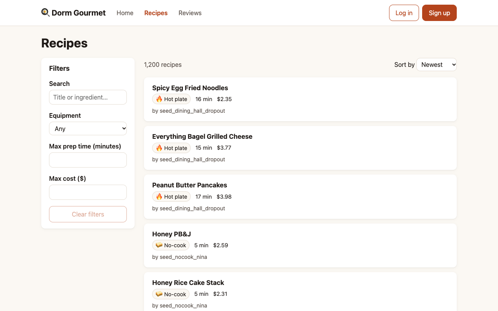
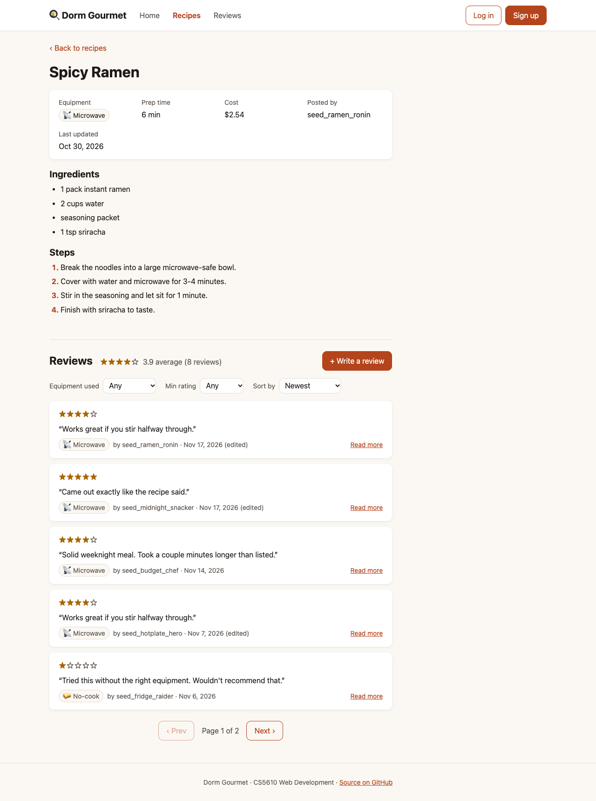
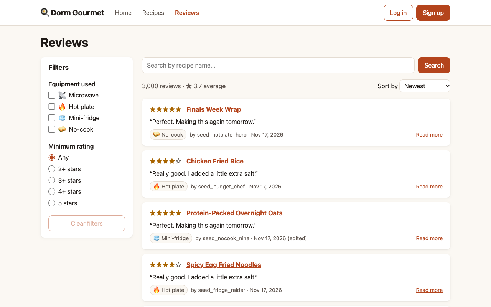
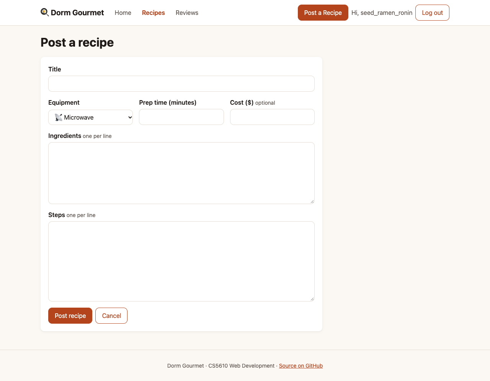
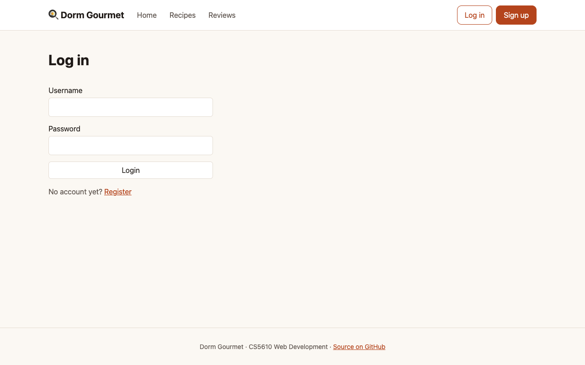
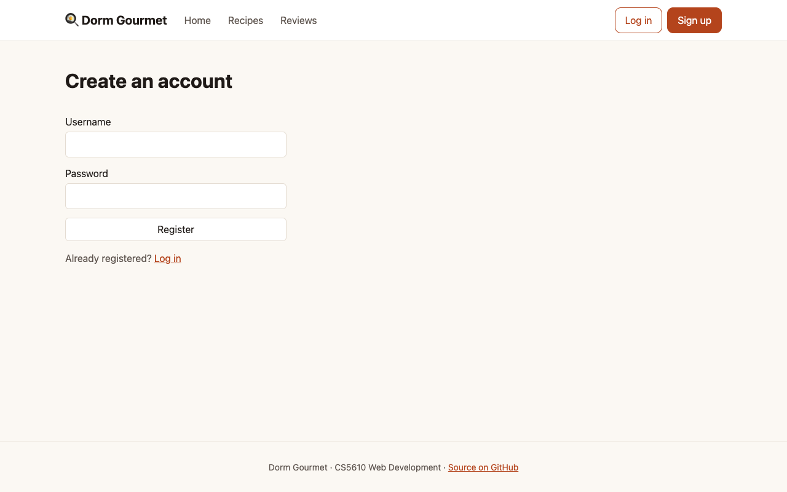

# Dorm Gourmet — Design Document

**CS5610 Web Development · Project 3**
**Team:** Jerith Gurusubburam (Recipes, Auth) · Julian Bowen (Reviews, Navigation, Home)

---

## 1. Project Description

Dorm Gourmet is a recipe-sharing site for students whose "kitchen" is a microwave, a hot plate, or a mini-fridge. General recipe sites assume a full kitchen with an oven, stovetop, and counter space, so a student without any of that has no reliable way to filter out recipes they physically can't make.

Dorm Gourmet has two independent sections:

- **Recipes.** Dishes tagged by required equipment (microwave / hot plate / mini-fridge / no-cook), prep time, and estimated cost.
- **Reviews.** Feedback from students who actually tried a recipe with their own equipment, confirming whether it works outside a full kitchen.

Anyone can search, filter, and read posts without logging in. Registered users can create posts and edit or delete their own. Each section has its own MongoDB collection with full CRUD. The database is seeded with at least 1,000 synthetic records.

### Goals

1. Let a student find a recipe they can make **tonight**, with the equipment they **have**, within their **budget** and **time**.
2. Surface real-world feedback tied to specific equipment, so "it works in a microwave" is something people have confirmed.
3. Keep posting low-friction for students who want to share recipes they already make.

### Non-goals

- Image uploads (posts are text only).
- Social features such as following, likes, or comments on reviews.
- Nutrition tracking or meal planning.

---

## 2. User Personas

### Maya: The Freshman on a Budget

|                |                                                                                                                                  |
| -------------- | -------------------------------------------------------------------------------------------------------------------------------- |
| **Year**       | First-year undergrad                                                                                                             |
| **Equipment**  | Mini-fridge, hot plate                                                                                                           |
| **Goal**       | Dinner under $5 in 15 minutes                                                                                                    |
| **Frustration** | Every recipe she finds online starts with "preheat the oven." She wastes time and money on ingredients for things she can't cook. |
| **Behavior**   | Browses on her phone between classes. Won't create an account just to look something up.                                        |

### Diego: The Seasoned Dorm Cook

|                 |                                                                                                                    |
| --------------- | ------------------------------------------------------------------------------------------------------------------ |
| **Year**        | Third-year, second year in the dorms                                                                               |
| **Equipment**   | Microwave, hot plate, mini-fridge                                                                                  |
| **Goal**        | Share the rotation of dorm-friendly recipes he's perfected and keep them up to date                               |
| **Frustration** | His recipes live in his notes app, and friends keep texting him for them. General recipe sites bury them.          |
| **Behavior**    | Willing to register. Edits his recipes when he finds a cheaper ingredient or a faster method.                     |

### Priya: The Careful Tester

|                 |                                                                                                                                       |
| --------------- | ------------------------------------------------------------------------------------------------------------------------------------- |
| **Year**        | Grad student in campus housing                                                                                                        |
| **Equipment**   | Microwave only                                                                                                                        |
| **Goal**        | Confirm a recipe actually works with her exact equipment before buying ingredients                                                    |
| **Frustration** | Recipes claim to be "microwave-friendly" and then come out raw or rubbery. Star ratings don't say what equipment the reviewer used. |
| **Behavior**    | Reads several reviews before cooking. Leaves detailed feedback and goes back to correct it if she tries the recipe again.             |

---

## 3. User Stories

### Recipes (Jerith Gurusubburam)

1. **Search and filter.** *As Maya, I want to search and filter recipes by keyword, equipment (microwave / hot plate / mini-fridge / no-cook), max prep time, and max cost, so I can quickly find something I can actually make tonight.*
   - It's 7 pm and Maya is hungry. She opens Dorm Gourmet, checks "Hot plate" and "Mini-fridge," sets max time to 15 minutes and max cost to $5, and gets a list of recipes she can start right away.

2. **Read a recipe.** *As Maya, I want to open a recipe and read its ingredients, steps, equipment tag, cost, author, and last-updated date, so I can decide if it's worth making.*
   - She opens "Hot-Plate Egg Fried Rice," sees it needs leftover rice and two eggs she already has, sees it was updated last week, and starts cooking.

3. **Manage my recipes.** *As Diego, I want to create, edit, and delete my own recipes, so I can share what works and keep details current.*
   - Diego logs in, posts his "Microwave Mug Mac & Cheese," and later edits the cost after finding a cheaper store-brand pasta. He deletes an old recipe he no longer makes. He can't see edit or delete buttons on anyone else's recipes.

### Reviews (Julian Bowen)

4. **Search and filter reviews.** *As Priya, I want to search and filter reviews by recipe, equipment used, and rating, so I can see whether a recipe actually worked for people with my setup.*
   - Priya is considering Diego's mac & cheese. She filters reviews for that recipe to "Microwave" only with rating 3+ and sees that most microwave-only reviewers say it works if you stir halfway through.

5. **Read a review.** *As Priya, I want to open a review and read the rating, comment, equipment used, author, and date, so I can judge how reliable it is.*
   - She opens a 2-star review, sees the reviewer used a 700W microwave and posted eight months ago, and decides it doesn't apply to her setup.

6. **Manage my reviews.** *As Priya, I want to create, edit, and delete my own reviews, so I can update or correct my feedback after the fact.*
   - After cooking, Priya posts a 4-star review tagged "Microwave." The next week she tries it again with less water, edits her review to 5 stars, and updates the comment with her tip.

---

## 4. Design Mockups

Each screen shows a screenshot of the implemented page on the live site (`docs/mockups/`, captured at 1280px wide in light mode), followed by the original low-fidelity wireframe it was built from. Layouts are responsive: on narrow screens, the filter sidebar collapses above the results list.

### 4.1 Shared Navigation (all pages)

The implemented navigation bar appears at the top of every screenshot below (logged out, and logged in on the recipe form).

Original wireframe:

```
┌──────────────────────────────────────────────────────────────────────┐
│ 🍳 Dorm Gourmet        Home   Recipes   Reviews        [Log in] [Sign up] │
└──────────────────────────────────────────────────────────────────────┘
 (logged in)                                       Hi, diego  [Log out]
```

### 4.2 Home Page



Original wireframe:

```
┌──────────────────────────────────────────────────────────────────────┐
│  NAV                                                                 │
├──────────────────────────────────────────────────────────────────────┤
│                                                                      │
│        Real recipes for a microwave, a hot plate, or a mini-fridge.  │
│                                                                      │
│   What do you have?                                                  │
│   [ Microwave ] [ Hot plate ] [ Mini-fridge ] [ No-cook ]            │
│                                                                      │
│   [ Search recipes…                                   ] [ Search ]   │
│                                                                      │
├──────────────────────────────────────────────────────────────────────┤
│  How it works                                                        │
│  1. Pick your equipment   2. Set time & budget   3. Check reviews    │
├──────────────────────────────────────────────────────────────────────┤
│  Recently reviewed                                                   │
│  ┌──────────────┐ ┌──────────────┐ ┌──────────────┐                  │
│  │ ★★★★☆ Mug Mac│ │ ★★★★★ Ramen  │ │ ★★★☆☆ Wrap   │                  │
│  │ Microwave    │ │ Hot plate    │ │ No-cook      │                  │
│  └──────────────┘ └──────────────┘ └──────────────┘                  │
└──────────────────────────────────────────────────────────────────────┘
```

### 4.3 Recipe Search / List (`/recipes`)



Original wireframe:

```
┌──────────────────────────────────────────────────────────────────────┐
│  NAV                                                                 │
├───────────────────┬──────────────────────────────────────────────────┤
│ FILTERS           │  [ Search: "rice"                    ] [Search]  │
│                   │  1,024 recipes · sorted by [Newest ▾]   [+ New]  │
│ Equipment         │ ┌──────────────────────────────────────────────┐ │
│ ☑ Microwave       │ │ Hot-Plate Egg Fried Rice                     │ │
│ ☑ Hot plate       │ │ 🔥 Hot plate · ⏱ 12 min · 💲 $2.50 · ★ 4.3 (18)│ │
│ ☐ Mini-fridge     │ │ by diego · updated Oct 28                    │ │
│ ☐ No-cook         │ └──────────────────────────────────────────────┘ │
│                   │ ┌──────────────────────────────────────────────┐ │
│ Max prep time     │ │ Microwave Mug Mac & Cheese                   │ │
│ [====●-----] 15m  │ │ 📡 Microwave · ⏱ 5 min · 💲 $1.75 · ★ 4.1 (32)│ │
│                   │ │ by diego · updated Oct 21                    │ │
│ Max cost          │ └──────────────────────────────────────────────┘ │
│ [===●------] $5   │   …                                              │
│                   │                                                  │
│ [ Clear filters ] │        [‹ Prev]  Page 1 of 52  [Next ›]          │
└───────────────────┴──────────────────────────────────────────────────┘
```

### 4.4 Recipe Detail (`/recipes/:id`)



Original wireframe:

```
┌──────────────────────────────────────────────────────────────────────┐
│  NAV                                                                 │
├──────────────────────────────────────────────────────────────────────┤
│  ‹ Back to recipes                                                   │
│                                                                      │
│  Microwave Mug Mac & Cheese                    [Edit] [Delete] ←owner│
│  📡 Microwave · ⏱ 5 min · 💲 $1.75                                    │
│  by diego · posted Sep 3 · updated Oct 21                            │
│                                                                      │
│  Ingredients                     Steps                               │
│  • 1/3 cup elbow pasta           1. Combine pasta and water in mug.  │
│  • 1/2 cup water                 2. Microwave 2 min, stir.           │
│  • 1/4 cup milk                  3. Microwave 2 more min.            │
│  • 1/3 cup shredded cheddar      4. Stir in milk and cheese.         │
│                                                                      │
├──────────────────────────────────────────────────────────────────────┤
│  Reviews  ★ 4.1 average (32)                       [+ Write a review]│
│  Filter: Equipment [Any ▾]  Min rating [Any ▾]                       │
│ ┌──────────────────────────────────────────────────────────────────┐ │
│ │ ★★★★★  "Works great if you stir halfway."                         │ │
│ │ 📡 Microwave · by priya · Oct 30                    [Read more]    │ │
│ └──────────────────────────────────────────────────────────────────┘ │
│ ┌──────────────────────────────────────────────────────────────────┐ │
│ │ ★★☆☆☆  "Boiled over in my 700W microwave."                        │ │
│ │ 📡 Microwave · by sam · Mar 2                       [Read more]    │ │
│ └──────────────────────────────────────────────────────────────────┘ │
└──────────────────────────────────────────────────────────────────────┘
```

### 4.5 Review Search / List (`/reviews`)



Original wireframe:

```
┌──────────────────────────────────────────────────────────────────────┐
│  NAV                                                                 │
├───────────────────┬──────────────────────────────────────────────────┤
│ FILTERS           │  [ Search recipe: "mac"              ] [Search]  │
│                   │  214 reviews · sorted by [Newest ▾]              │
│ Equipment used    │ ┌──────────────────────────────────────────────┐ │
│ ☑ Microwave       │ │ ★★★★★  Microwave Mug Mac & Cheese             │ │
│ ☐ Hot plate       │ │ "Works great if you stir halfway."           │ │
│ ☐ Mini-fridge     │ │ 📡 Microwave · by priya · Oct 30              │ │
│ ☐ No-cook         │ └──────────────────────────────────────────────┘ │
│                   │ ┌──────────────────────────────────────────────┐ │
│ Minimum rating    │ │ ★★★★☆  Stovetop Mac for One                   │ │
│ ( ) Any           │ │ "Needed more milk than listed."              │ │
│ ( ) 2+  (●) 3+    │ │ 🔥 Hot plate · by alex · Oct 12               │ │
│ ( ) 4+  ( ) 5     │ └──────────────────────────────────────────────┘ │
│                   │   …                                              │
│ [ Clear filters ] │        [‹ Prev]  Page 1 of 11  [Next ›]          │
└───────────────────┴──────────────────────────────────────────────────┘
```

### 4.6 Review Detail (`/reviews/:id`)

<!-- TODO: save a 1280px-wide light-mode screenshot as docs/mockups/review-detail.png, then replace this comment with:
 -->

Original wireframe:

```
┌──────────────────────────────────────────────────────────────────────┐
│  NAV                                                                 │
├──────────────────────────────────────────────────────────────────────┤
│  ‹ Back to reviews                                                   │
│                                                                      │
│  Review of: Microwave Mug Mac & Cheese  (link to recipe)             │
│                                                [Edit] [Delete] ←owner│
│  ★★★★★  5 / 5                                                        │
│  Equipment used: 📡 Microwave                                         │
│  by priya · posted Oct 23 · updated Oct 30                           │
│                                                                      │
│  "Works great if you stir halfway. I used 2 tbsp less water than     │
│   listed and it came out perfect in a 1000W microwave."              │
└──────────────────────────────────────────────────────────────────────┘
```

### 4.7 Recipe Form (`/recipes/new`, `/recipes/:id/edit`)



Original wireframe:

```
┌──────────────────────────────────────────────────────────────────────┐
│  NAV                                                                 │
├──────────────────────────────────────────────────────────────────────┤
│  New Recipe                                                          │
│                                                                      │
│  Title            [ Microwave Mug Mac & Cheese                    ]  │
│  Description      [ A 5-minute single-serving mac…                ]  │
│  Equipment        ☑ Microwave ☐ Hot plate ☐ Mini-fridge ☐ No-cook    │
│  Prep time (min)  [ 5   ]        Est. cost ($) [ 1.75 ]              │
│                                                                      │
│  Ingredients (one per line)                                          │
│  ┌────────────────────────────────────────────────────────────────┐  │
│  │ 1/3 cup elbow pasta                                            │  │
│  │ 1/2 cup water                                                  │  │
│  └────────────────────────────────────────────────────────────────┘  │
│  Steps (one per line)                                                │
│  ┌────────────────────────────────────────────────────────────────┐  │
│  │ Combine pasta and water in a large mug.                        │  │
│  └────────────────────────────────────────────────────────────────┘  │
│                                                                      │
│                                         [ Cancel ]  [ Save recipe ]  │
└──────────────────────────────────────────────────────────────────────┘
```

### 4.8 Review Form (`/reviews/new?recipeId=…`, `/reviews/:id/edit`)

<!-- TODO: save a 1280px-wide light-mode screenshot as docs/mockups/review-form.png, then replace this comment with:
 -->

Original wireframe:

```
┌──────────────────────────────────────────────────────────────────────┐
│  NAV                                                                 │
├──────────────────────────────────────────────────────────────────────┤
│  Review: Microwave Mug Mac & Cheese                                  │
│                                                                      │
│  Rating           ( )1  ( )2  ( )3  ( )4  (●)5                       │
│  Equipment used   ☑ Microwave ☐ Hot plate ☐ Mini-fridge ☐ No-cook    │
│  Comment                                                             │
│  ┌────────────────────────────────────────────────────────────────┐  │
│  │ Works great if you stir halfway…                               │  │
│  └────────────────────────────────────────────────────────────────┘  │
│                                                                      │
│                                         [ Cancel ]  [ Save review ]  │
└──────────────────────────────────────────────────────────────────────┘
```

### 4.9 Log In / Sign Up (`/login`, `/register`)




Original wireframe:

```
┌──────────────────────────────────────┐
│  Log in to Dorm Gourmet              │
│                                      │
│  Username  [                      ]  │
│  Password  [                      ]  │
│                                      │
│  [ Log in ]                          │
│  No account? Sign up                 │
└──────────────────────────────────────┘
```

---

## 5. Architecture

```
 Browser (React SPA)                     Node + Express                MongoDB Atlas
┌──────────────────────┐   fetch()   ┌───────────────────────┐      ┌────────────────┐
│ React Router pages   │ ──────────▶ │ /api/auth   (Passport) │ ───▶ │ users          │
│ components + hooks   │ ◀────────── │ /api/recipes           │ ───▶ │ recipes        │
│                      │   JSON      │ /api/reviews           │ ───▶ │ reviews        │
└──────────────────────┘             │ static: frontend/dist  │ ───▶ │ sessions       │
                                     └───────────────────────┘      └────────────────┘
```

- **Single origin, no CORS.** In development the Vite dev server proxies `/api` to Express. In production Express serves the built React app from `frontend/dist`, and any non-API path returns `index.html` so React Router handles it (a refresh on `/reviews/123` works). The frontend and API share one origin, so the `cors` package is never needed. Unknown `/api` paths return a JSON 404.
- **Authentication.** Passport local strategy + `express-session`, with sessions stored in MongoDB by `connect-mongo` so a server restart doesn't log anyone out. Passwords are hashed with `bcryptjs`. Session cookies are `httpOnly`, `sameSite: lax`, and `secure` in production; Express trusts Render's proxy in production so the secure cookie is set behind HTTPS.
- **Authorization.** A `requireAuth` middleware rejects unauthenticated writes with `401`. Update and delete handlers compare the document's owner to `req.user._id` (`ownerId` on recipes, `authorId` on reviews) and return `403` otherwise.
- **Database access.** The native MongoDB driver only, with one module per collection under `backend/db/`. Configuration comes from environment variables (`MONGO_URI`, `DB_NAME`, `SESSION_SECRET`, `PORT`, `NODE_ENV`), loaded from `backend/.env` in development via `dotenv`.

---

## 6. Data Model

### `users`

| Field          | Type     | Notes                                                  |
| -------------- | -------- | ------------------------------------------------------ |
| `_id`          | ObjectId |                                                        |
| `username`     | string   | unique index                                           |
| `passwordHash` | string   | bcrypt hash, never sent to the client                  |
| `seeded`       | boolean  | only on seed users, so re-seeding leaves real accounts |
| `createdAt`    | Date     |                                                        |

### `recipes` (Jerith)

| Field         | Type         | Notes                                                       |
| ------------- | ------------ | ----------------------------------------------------------- |
| `_id`         | ObjectId     |                                                             |
| `title`       | string       | required; keyword search matches title or ingredients       |
| `equipment`   | string       | one of `microwave`, `hot-plate`, `mini-fridge`, `no-cook`   |
| `prepTime`    | number       | minutes, positive                                           |
| `cost`        | number\|null | estimated USD, non-negative; `null` when not listed         |
| `ingredients` | string[]     | non-empty                                                   |
| `steps`       | string[]     | non-empty                                                   |
| `ownerId`     | ObjectId     | ref `users._id`; the owner's username is joined at read time |
| `createdAt`   | Date         |                                                             |
| `updatedAt`   | Date         | shown as "last updated"                                     |

### `reviews` (Julian)

| Field           | Type     | Notes                                                       |
| --------------- | -------- | ----------------------------------------------------------- |
| `_id`           | ObjectId |                                                             |
| `recipeId`      | ObjectId | ref `recipes._id`; indexed with `createdAt`                 |
| `recipeTitle`   | string   | denormalized so lists, search, and removed recipes show it  |
| `rating`        | number   | integer 1–5, indexed                                        |
| `comment`       | string   | required, up to 2,000 characters                            |
| `equipmentUsed` | string[] | one or more of the recipe equipment values                  |
| `authorId`      | ObjectId | ref `users._id`, indexed                                    |
| `authorName`    | string   | denormalized for display                                    |
| `createdAt`     | Date     | indexed                                                     |
| `updatedAt`     | Date     | equals `createdAt` until the review is edited               |

### `sessions`

Managed by `connect-mongo` for `express-session`; not accessed directly by app code.

### Synthetic data

Each seed script generates well over 1,000 records by itself, so each section meets the requirement independently:

- `backend/seed.js` (`npm run seed`): 8 seed users sharing the demo password `seed-password-123`, and 1,200 recipes built from dish templates and variations, spread evenly across the four equipment types. Prep times range from 5 to 45 minutes and costs from $1 to $15, with about 15% of recipes having no listed cost. Creation dates are spread over the past 180 days. Re-running it replaces only seed users and their recipes.
- `backend/seedReviews.js` (`npm run seed:reviews`, run after `seed`): 3,000 reviews spread across the recipes and users in the database. About 85% use the recipe's own equipment; the rest used something else and skew to low ratings. Ratings otherwise skew positive, and about 20% show as edited. Re-running it replaces all reviews.

---

## 7. REST API

All responses are JSON. 🔒 = login required (`401` otherwise). 👤 = owner only (`403` otherwise).

### Auth (Jerith)

| Method | Path                 | Description                                                                       |
| ------ | -------------------- | --------------------------------------------------------------------------------- |
| POST   | `/api/auth/register` | Create an account (password at least 8 characters) and log in. `409` if taken.    |
| POST   | `/api/auth/login`    | Passport local login. `401` on a wrong username or password.                      |
| POST   | `/api/auth/logout`   | End the session                                                                   |
| GET    | `/api/auth/me`       | Current user `{ id, username, createdAt }`, or `401` when logged out              |

### Recipes (Jerith)

| Method | Path               | Description                                                                                                                                                            |
| ------ | ------------------ | ---------------------------------------------------------------------------------------------------------------------------------------------------------------------- |
| GET    | `/api/recipes`     | List. Query: `keyword` (title or ingredients), `equipment` (one value), `maxPrepTime`, `maxCost`, `page`, `limit` (default 20, max 100), `sort` (`newest`, `cheapest`, `fastest`). Returns `{ recipes, totalCount, page, limit, totalPages }`. |
| GET    | `/api/recipes/:id` | One recipe, including `ownerUsername`                                                                                                                                  |
| POST   | `/api/recipes`     | 🔒 Create                                                                                                                                                              |
| PUT    | `/api/recipes/:id` | 🔒👤 Update                                                                                                                                                            |
| DELETE | `/api/recipes/:id` | 🔒👤 Delete                                                                                                                                                            |

Recipe validation errors return `400 { error, details: [messages] }`. Recipes are returned with string ids as `id`.

### Reviews (Julian)

| Method | Path               | Description                                                                                                                                                                          |
| ------ | ------------------ | ------------------------------------------------------------------------------------------------------------------------------------------------------------------------------------ |
| GET    | `/api/reviews`     | List. Query: `recipeId`, `q` (recipe title), `equipment` (comma list), `minRating`, `page`, `limit` (default 10, max 50), `sort` (`newest`, `oldest`, `highest`, `lowest`). Returns `{ reviews, total, page, totalPages, averageRating }`, where `averageRating` covers every matching review. |
| GET    | `/api/reviews/:id` | One review, plus `recipeExists`                                                                                                                                                      |
| POST   | `/api/reviews`     | 🔒 Create (body includes `recipeId`, which must exist)                                                                                                                               |
| PUT    | `/api/reviews/:id` | 🔒👤 Update `rating`, `comment`, `equipmentUsed`                                                                                                                                     |
| DELETE | `/api/reviews/:id` | 🔒👤 Delete                                                                                                                                                                          |

Review validation errors return `400 { error, errors: { field: message } }` so the form can show each message next to its field. Reviews are returned as stored, with `_id`.

Recipe deletion behavior: reviews of a deleted recipe stay readable, and the review detail page shows "This recipe has been removed."

---

## 8. Frontend Structure

Each component is in its own file with a CSS file of the same name, imported by that component. Every component that receives props defines `propTypes`.

| Route                 | Page component       | Owner  |
| --------------------- | -------------------- | ------ |
| `/`                   | `HomePage`           | Julian |
| `/recipes`            | `RecipeList`         | Jerith |
| `/recipes/new`        | `RecipeForm` 🔒      | Jerith |
| `/recipes/:id`        | `RecipeDetail`       | Jerith |
| `/recipes/:id/edit`   | `RecipeForm` 🔒      | Jerith |
| `/reviews`            | `ReviewsPage`        | Julian |
| `/reviews/new`        | `ReviewFormPage` 🔒  | Julian |
| `/reviews/:id`        | `ReviewDetailPage`   | Julian |
| `/reviews/:id/edit`   | `ReviewFormPage` 🔒  | Julian |
| `/login`, `/register` | `Login`, `Register`  | Jerith |
| anything else         | `NotFound`           | Jerith |

🔒 routes are wrapped in `RequireAuth`, which sends logged-out users to `/login` and back to the original page afterwards.

**Shared (Julian):** `NavBar`, `Layout`, `Pagination`, `EquipmentBadge`, `StarRating`, `utils/format.js`, `utils/query.js`
**Shared (Jerith):** `AuthContext` / `useAuth`, `api.js` (fetch wrapper), `RequireAuth`, `AuthForm`
**Reviews (Julian):** `ReviewFilters`, `ReviewList`, `ReviewCard`, `ReviewForm`, `RecipeReviews` (embedded on recipe detail)

The recipe and review list pages keep their filters, sort, and page in the URL, so filtered views can be bookmarked and the back button works.

### Accessibility and HTML

- Real `<button>`, `<a>`/`<Link>`, `<form>`, `<label>`, `<input>`, `<select>`, and `<fieldset>` elements. No clickable `div`s or `span`s.
- Star ratings in forms are a radio group in a `<fieldset>` with a `<legend>`.
- Visible focus states, a skip-to-content link, and color contrast that meets WCAG AA.

---

## 9. Work Division

| Area                                        | Jerith | Julian |
| ------------------------------------------- | :----: | :----: |
| `recipes` collection, seed script, CRUD API | ✅     |        |
| Recipe search, detail, and form components  | ✅     |        |
| Register / login / logout, Passport         | ✅     |        |
| `reviews` collection, seed script, CRUD API |        | ✅     |
| Review list, detail, and form components    |        | ✅     |
| Reviews on recipe detail page               |        | ✅     |
| Navigation, layout, home page               |        | ✅     |
| ESLint / Prettier config, README, deploy    | ✅     | ✅     |

**Dependency:** reviews reference `recipes._id`, so the recipe detail route and the `recipes` seed must land before the review detail view and review seed can be fully tested.

---

## 10. Tech Stack and Approved Libraries

- **Frontend:** React 19 (Hooks), React Router 7 (`react-router-dom`), `prop-types`, Fetch API, CSS, built with Vite
- **Backend:** Node.js, Express 5, `passport`, `passport-local`, `express-session`, `connect-mongo`, `bcryptjs`, `dotenv`, `mongodb` (native driver)
- **Tooling:** ESLint, Prettier, nodemon
- **Not used:** axios, Mongoose, `cors`
- **Deployment:** Render web service (Express serves the API and the built frontend), MongoDB Atlas
